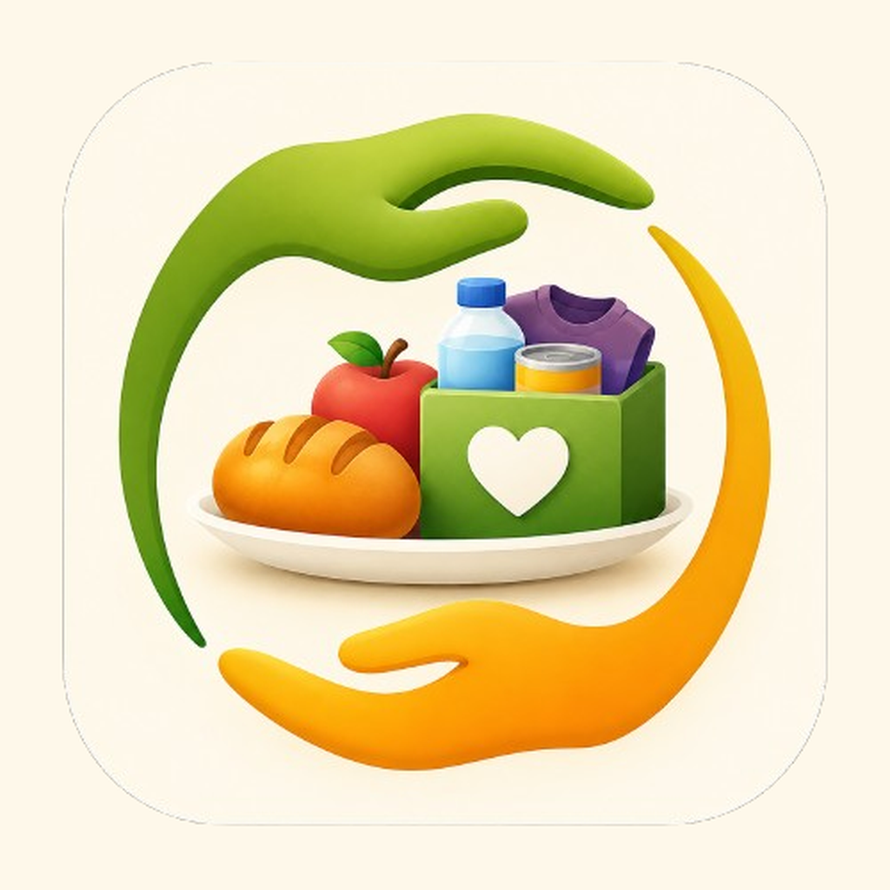

# SharePlate Neighbors

Chicago food-sharing app. Find free food nearby and share extra meals instead of throwing them away.

Pantries, neighbor donations, and grocery / restaurant surplus on one map.

## Run it

1. Open `sharePlate.xcodeproj` in Xcode.
2. Run on simulator or iPhone.
3. No login needed. An account is created automatically.

Set the device to Chicago to see listings. If location is off, the map starts downtown Chicago.

## Main features

- Map: browse nearby pantries and food pins.
- Filters: Food, Dry, Drop off, Pickup, Grocery, Restaurant.
- Listing: tap a pin to see details, then Reserve to get a booking code.
- Post: Food tab → Post Food with a photo.
- Activity: track bookings, posts, and history.

## Backend

Supabase for auth, listings, photos, and live updates. Pantry data from the Greater Chicago Food Depository.

Run the files in `supabase/` once in the SQL Editor. Copy `.env.example` to `.env` for local scripts only.
